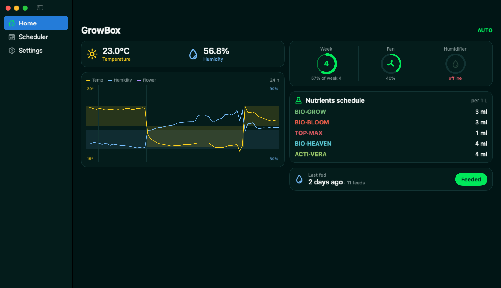

# Growbox macOS app



The GrowBox phone app as a Mac window: a sidebar with Home, Scheduler and
Settings, the same colours, cards, rules and ESP API calls as the
[app](https://github.com/growbox-DIY/app).

- **Home** (two columns): temperature and humidity, the climate chart with
  target bands and the flowering start (click it: 24 h / 7 days), the
  flowering week, fan and humidifier, the week's nutrients (Auto) or the
  veg nutrients (Manual), "End of period" from week 9, and the last
  watering with the Feeded button (confirm step, locked for 24 h).
- **Scheduler**: light on/off times (Auto mode only).
- **Settings**: Manual / Auto; light, fan, Auto fan, day fan level (Manual);
  flowering start, fan speed, night fan and its level (Auto); the OLED
  display and the TFT monitor (on/off, brightness).
- **Reminders**: day 3 without a watering at 19:00, then from day 4 a
  time-sensitive alert every 2 h, 8:00-22:00.

## Setup

Same settings file as the macOS widget, `~/.config/growbox/widget.json`:

```json
{ "url": "http://192.168.18.85", "token": "<API_TOKEN from App/api_token.py>" }
```

If the ESP moves to another address, the app finds it on the local network.
On first start macOS asks for access to the local network - allow it.

## Build and run

```bash
./build.sh install
```

Ad-hoc signed for this Mac: no Apple account, it does not expire. The week
of history is cached in `~/Library/Application Support/GrowBox/history.json`.

`GrowBox --snapshot out.png [--snapshot-section Home|Scheduler|Settings]
[--snapshot-delay 10] [--chart-week]` saves the whole window (sidebar
included) as a PNG and quits.

## License

This project is licensed under [CC BY-NC 4.0](https://creativecommons.org/licenses/by-nc/4.0/):
you may use, share and modify it for non-commercial purposes, with credit to
growbox-DIY. See LICENSE.
